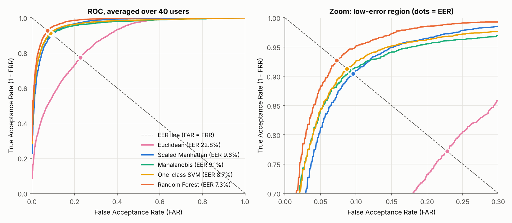
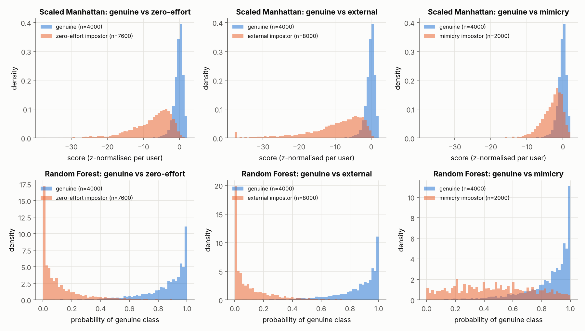
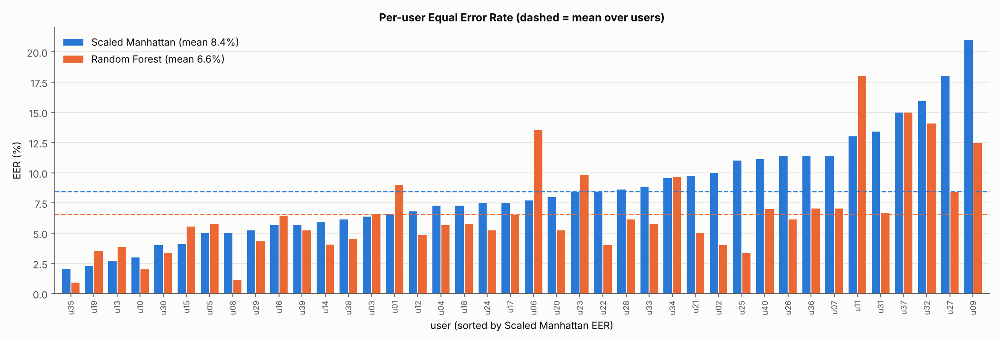

# Keystroke-Dynamics Authentication

**Verifying who is typing from their typing rhythm.** This repository is a self-contained research
mini-project on *behavioural biometric authentication*: given a user who claims an identity and
types a fixed passphrase, decide from key **hold times** and **inter-key latencies** whether they
are the genuine account owner or an impostor. It covers synthetic data generation, feature
extraction, five verification models, an evaluation protocol with three impostor types, and a
written paper.

- **Code:** `src/` (modular, commented) + `run_pipeline.py` (one command reproduces everything)
- **Results:** `results/` (metrics CSVs, per-user scores, figures)
- **Paper:** [`paper/paper.md`](paper/paper.md)

## Headline results (seed 42, 40 users, mean over users)

| Model | Family | EER | ROC-AUC | FAR | FRR | HTER | Accuracy |
|---|---|---|---|---|---|---|---|
| Euclidean | distance | 21.94 % | 0.868 | 20.54 % | 25.20 % | 22.87 % | 78.59 % |
| Scaled Manhattan | distance | 8.45 % | 0.965 | 10.20 % | 8.92 % | 9.56 % | 90.04 % |
| Mahalanobis | distance | 8.09 % | 0.960 | 12.12 % | 7.07 % | 9.60 % | 88.81 % |
| One-class SVM | one-class learner | 7.71 % | 0.964 | 10.95 % | 6.90 % | 8.92 % | 89.80 % |
| **Random Forest** | **two-class classifier** | **6.56 %** | **0.978** | **9.21 %** | **5.75 %** | **7.48 %** | **91.43 %** |

FAR/FRR/HTER/accuracy are measured at a threshold fixed *beforehand* on validation data; EER and
AUC are threshold-free. Key findings (details in the [paper](paper/paper.md)):

- **The classifier wins with enough data.** RF beats Scaled Manhattan on 28/40 users (sign test
  p = 0.009, 95 % CI of the EER gap +0.9 to +2.9 pp). The ranking RF < One-class SVM <
  Mahalanobis ≈ Scaled Manhattan < Euclidean is the same on 5 re-generated populations
  (RF EER 6.51 ± 0.34 %).
- **With only 5 enrolment samples, simple wins:** Scaled Manhattan 12.2 % vs. RF 14.5 % EER.
- **Hold times + one latency family are complementary** (EER roughly halves), but DD and UD are
  redundant given H (`UD = DD − H`).
- **Mimicry is the real threat:** an attacker imitating the victim's rhythm raises the EER to
  18.6–22.0 % and is accepted **41–44 %** of the time at the deployed threshold (vs. ~5 % for
  zero-effort impostors).
- Difficulty is a property of the user (per-user EER from 0.9 % to 18 % for RF); inconsistent
  typists are the hard cases.

| ROC with EER points | Genuine vs. impostor scores |
|---|---|
|  |  |



**Reproducibility check:** two independent clean runs of `python run_pipeline.py` produced
byte-identical data, CSVs and figures.


## Quick start

```bash
python -m venv .venv && source .venv/bin/activate   # optional
pip install -r requirements.txt
python -m unittest discover tests                   # 8 sanity tests, < 2 s
python run_pipeline.py                              # full run, ~6.5 min on 4 cores
python run_pipeline.py --quick                      # skips the 5-seed robustness study (~4.5 min)
```

Only `numpy`, `pandas`, `scikit-learn` and `matplotlib` are required (results were produced
with Python 3.13.18, numpy 2.5.3, pandas 3.0.5, scikit-learn 1.9.1, matplotlib 3.11.2). Every random draw derives from
`--seed` (default 42), so a re-run reproduces every CSV and figure bit-for-bit on the same library
versions.

## Repository layout

```
run_pipeline.py          end-to-end driver: data -> features -> experiments -> results/
src/config.py            every tunable number (population, protocol) in one place
src/data_generation.py   synthetic keystroke generator (raw press/release event log)
src/features.py          event log -> 39 timing features (H, DD, UD, total time, speed)
src/protocol.py          per-user train / validation / test splits, impostor partitions
src/models.py            5 verifiers with a common fit/score interface
src/metrics.py           FAR, FRR, EER, HTER, ROC-AUC, averaged ROC
src/experiments.py       main experiment, learning curve, feature ablation, sessions, seeds
src/plots.py             all figures
tests/test_pipeline.py   unit tests (feature maths, EER vs. theory, leakage, determinism)
data/                    keystroke_events.csv.gz  (generated raw event log, committed)
results/                 metrics + figures (committed); paper/ the write-up
```

## Design

### 1. Dataset (synthetic, documented)

The canonical public benchmark (CMU *DSL-StrongPassword*, Killourhy & Maxion 2009) could not be
downloaded from the build environment (the host was blocked by the network policy), so — as the
project brief allows — a **documented generative model** produces the data instead. It was designed
so the task is *not* trivially separable; it reproduces the main effects reported in the keystroke
literature:

| Effect | How it is modelled |
|---|---|
| Keyboard geometry | per-digraph latency factors: hand alternation fast (x0.75), same-finger slow (x1.35), row travel, number-row reach, Shift chord for `B`, punctuation, Return |
| Between-user differences | log-normal user speed and hold tendency (correlated, rho = 0.4) + per-key / per-digraph idiosyncrasies |
| Within-user variability | user-specific coefficient of variation for holds (8–22 %) and latencies (12–35 %) |
| Day-to-day tempo | per-sample global tempo factor shared by all latencies |
| Session drift | per-session global and per-feature log-normal offsets |
| Practice / learning | latencies shrink as `1 + g·exp(−rep/τ)` over repetitions (template ageing) |
| Hesitations | rare exponential pauses added to a latency |
| Key rollover | `UD = DD − H` is derived, so it is negative when keys overlap |
| Logger resolution | timestamps quantised to 0.1 ms |

Population: **40 enrolled users × 200 repetitions** of the passphrase `sunset.Bay42` + Return
(8 sessions × 25 reps, mirroring the CMU design), **20 external never-enrolled users × 20 reps**,
and **50 mimicry attempts per target** (5 attackers × 10). A mimicry attacker's mean timings are a
log-space blend of their own and the victim's profile (weight α ∈ [0.45, 0.85]) with 35 % extra
variability — a model of someone who has observed the victim's rhythm (cf. Tey et al., 2013).

The generator writes a **raw event log** (`sample_id, subject, …, key, press_ms, release_ms`), so
the feature extractor works exactly as on real key-logger data.

### 2. Features (39 per sample)

For the 13 keys of the passphrase: 13 **hold** times `H.k`, 12 **down-down** latencies `DD.k.k+1`,
12 **up-down** (flight) latencies `UD.k.k+1`, plus `total_ms` and `speed_cps` (characters/second).

### 3. Verification protocol (one problem per user)

| Data | Used for |
|---|---|
| genuine reps 0–79 (sessions 1–4) | enrolment / model fitting |
| genuine reps 80–99 | validation: choose the decision threshold *a priori* (validation EER point) |
| genuine reps 100–199 (sessions 5–8) | **test genuine** (later sessions ⇒ realistic ageing) |
| 20 random other enrolled users ("background") | training negatives for the classifier (reps 0–9) + validation negatives (reps 10–14) |
| the other 19 enrolled users | **test zero-effort impostors** (10 reps each) |
| 20 external users | **test external impostors** (10 reps each, never seen by any model) |
| 50 mimicry attempts on this user | **test mimicry impostors** |

Background and test impostor populations are disjoint, so the classifier is never tested on
impostors it saw in training. Threshold-free metrics (EER, AUC) are computed on test scores;
FAR / FRR / accuracy / HTER are reported at the threshold fixed on validation data.

### 4. Models compared

| Family | Model | Training data | Score |
|---|---|---|---|
| distance / threshold | **Euclidean** (baseline) | genuine only | −‖x − μ‖₂ |
| distance / threshold | **Scaled Manhattan** | genuine only | −Σ \|xᵢ − μᵢ\| / MADᵢ |
| distance / threshold | **Mahalanobis** (Ledoit–Wolf shrinkage) | genuine only | −√(dᵀ Σ⁻¹ d) |
| one-class learner | **One-class SVM** (RBF, ν = 0.1) | genuine only | decision function |
| two-class classifier | **Random Forest** (200 trees, balanced) | genuine + background impostors | P(genuine) |

### 5. Metrics

FAR (impostors accepted), FRR (genuine rejected), **EER** (FAR = FRR, from per-user ROC by linear
interpolation), **ROC-AUC**, HTER = (FAR+FRR)/2 and accuracy at the a-priori threshold. All are
computed **per user** and averaged; the averaged ROC curve is the vertical average of per-user ROCs.

## Outputs

| File | Content |
|---|---|
| `results/metrics_overall.csv` | per model: mean & std over users of every metric (+ EER of averaged ROC) |
| `results/metrics_per_user.csv` | per user × model: EER, AUC, FAR, FRR, HTER, accuracy, threshold, EER/FAR per impostor type |
| `results/scores.csv.gz` | every test score (user, model, label, impostor kind, session, raw & normalised score, decision) |
| `results/roc_mean.csv` | averaged ROC curves |
| `results/model_comparison.csv` | paired bootstrap CI + sign test of each model vs. the best |
| `results/learning_curve.csv`, `feature_ablation.csv`, `session_eer.csv`, `seed_robustness.csv` | secondary experiments |
| `results/user_difficulty_spearman.csv` | correlation of per-user EER with the generator's latent user parameters |
| `results/summary.json` | headline numbers + library versions + runtime |
| `results/figures/*.png` | ROC with EER points, score distributions, per-user EER bars, impostor types, learning curve, ablation heat-map, session EER, data overview |

## Limitations

The data is synthetic: absolute error rates depend on the generator's parameters and should not be
read as a claim about real users. The *relative* findings (model ranking, feature complementarity,
the danger of mimicry) are what the study supports. See §5 of the paper.
