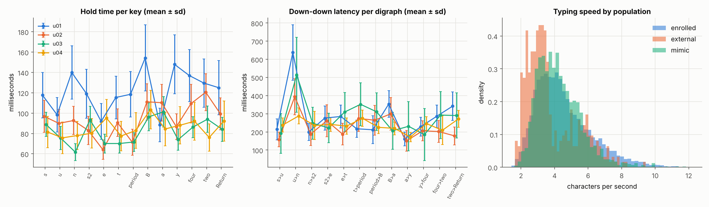
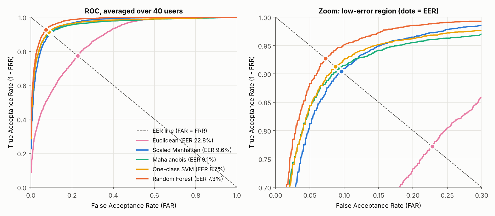
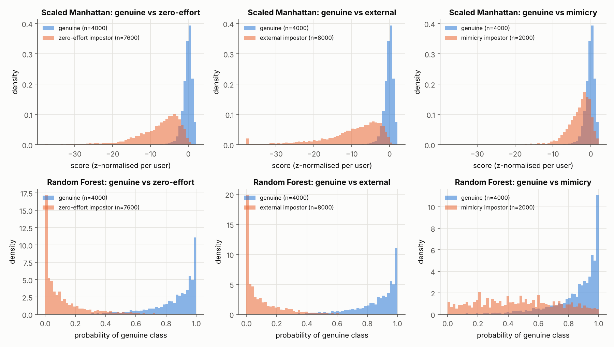
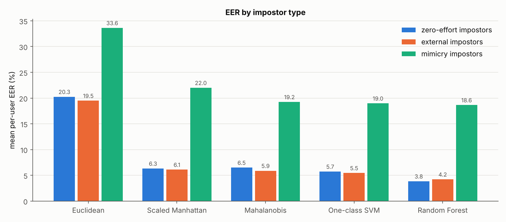
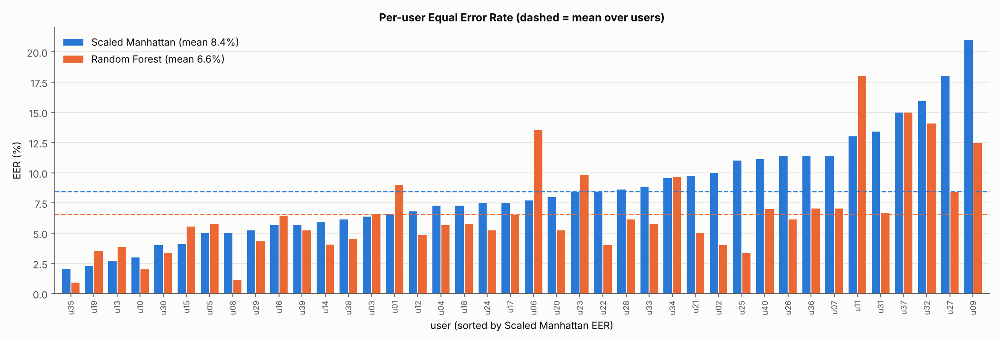
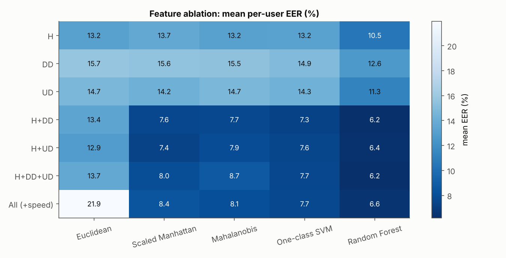
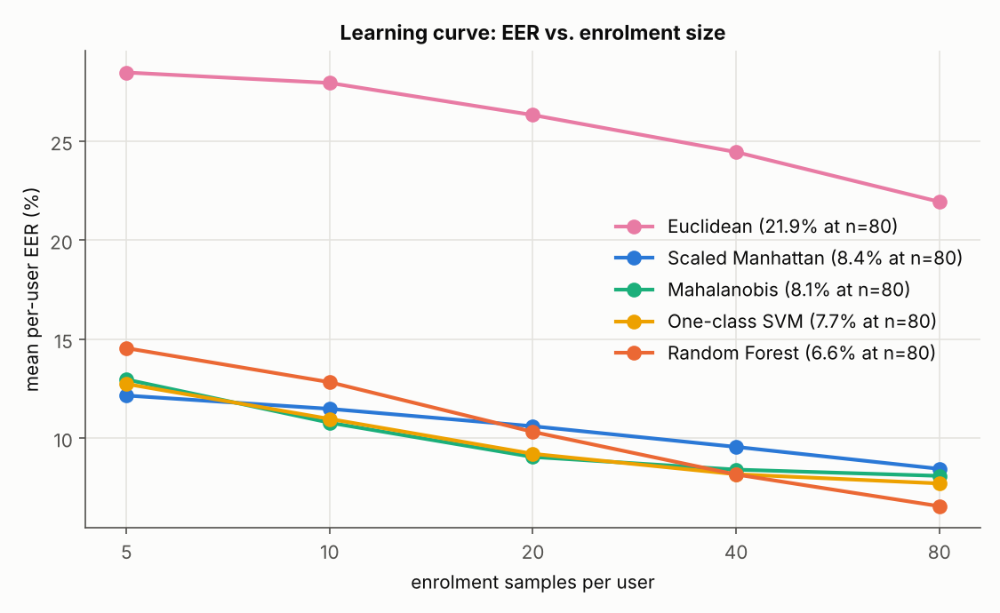
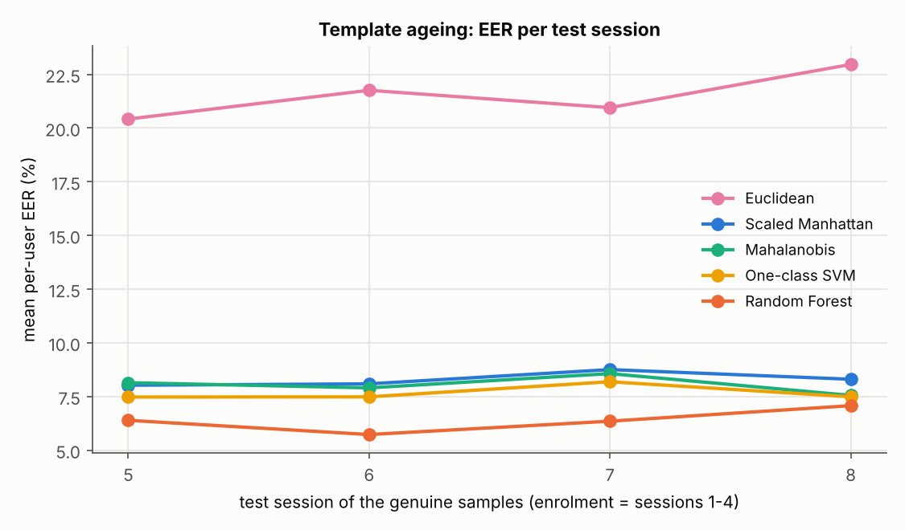

# Behavioural Biometric Authentication from Keystroke Dynamics: Distance Detectors vs. a Discriminative Classifier on a Documented Synthetic Benchmark

*Keystroke-Dynamics Authentication mini-project — November 2026*

## Abstract

Passwords verify what a user knows, not who the user is. Keystroke dynamics adds a transparent
behavioural factor: the rhythm with which a person types a passphrase. We frame keystroke dynamics
as per-user verification and build a fully reproducible pipeline around it. Because the CMU
keystroke benchmark could not be retrieved from our build environment, we contribute a documented
generative model of typing behaviour — keyboard-geometry-dependent latencies, user-specific
idiosyncrasies and variability, session drift, practice effects, hesitations and key rollover —
that emits raw press/release event logs for 40 enrolled users (200 repetitions each), 20 external
users and 2,000 targeted mimicry attempts. From each attempt we extract 39 features (hold,
down-down and up-down times, total time, speed) and compare four distance/one-class detectors
(Euclidean, Scaled Manhattan, Mahalanobis, One-class SVM) with a two-class Random Forest under a
leakage-free protocol with an a-priori decision threshold. The Random Forest performs best, with a
mean per-user equal error rate (EER) of 6.56 % (ROC-AUC 0.978, FAR 9.21 %, FRR 5.75 %), against
7.71–8.45 % for the best one-class detectors and 21.94 % for the Euclidean baseline. The ranking
is identical on five independently generated populations, and the classic detectors land close to
the error rates published for real users. Ablations show that hold times and latencies are
complementary while down-down and up-down latencies are redundant; with only five enrolment
samples the simple Scaled Manhattan detector beats the classifier. Imitation is the main threat:
mimicry attacks raise the EER to 18.6–22.0 % and are accepted 41–44 % of the time at the deployed
threshold. Keystroke dynamics is thus a useful invisible second factor, not a standalone
authenticator, and timing data must be protected as a credential.

**Keywords:** behavioural biometrics, keystroke dynamics, user verification, equal error rate,
anomaly detection, random forest, mimicry attack.

## 1 Introduction

Passwords remain the dominant authentication factor, yet they authenticate *knowledge*, not
*people*: a stolen, phished or shoulder-surfed password grants an attacker full access.
Multi-factor authentication mitigates this but adds friction and cost. **Behavioural biometrics**
offer a complementary, transparent factor that is derived from *how* a user interacts with a
device rather than *what* they know. Among behavioural modalities, **keystroke dynamics** — the
timing pattern of key presses and releases — is attractive because it needs no extra sensor, can
be collected silently while the password is typed, and can be revoked or re-enrolled simply by
choosing a new passphrase [1, 2, 3].

This work frames keystroke dynamics as a **per-user verification** (1:1) problem: a user claims an
identity and types a fixed passphrase; the system must accept the genuine owner and reject
impostors. We build a complete, reproducible pipeline and use it to answer four questions:

1. How do classic *distance/threshold* anomaly detectors, trained only on the owner's samples,
   compare with a *discriminative classifier* trained on the owner plus a background population?
2. Which timing features (hold, down-down, up-down, global speed) carry the identity signal?
3. How many enrolment samples are needed, and does performance degrade over later sessions?
4. How robust is the scheme against an attacker who *imitates* the victim's rhythm, compared with
   ordinary (zero-effort) impostors?

Because the canonical public benchmark (the CMU DSL-StrongPassword dataset [4]) could not be
retrieved from our build environment, we contribute a **documented generative model** of
keystroke timing that reproduces the main effects reported in the literature — keyboard geometry,
user-specific idiosyncrasies, within-user variability, session drift, practice effects,
hesitations and key rollover — and emits raw press/release event logs. The full code, data,
results and this paper are produced by a single command.

**Contributions.** (i) An open, parameterised keystroke-timing generator with three impostor
populations (zero-effort, external, mimicry); (ii) a leakage-free per-user evaluation protocol with
an *a-priori* threshold; (iii) a comparison of five verifiers with per-user and pooled metrics,
paired significance tests, a feature ablation, a learning curve, a template-ageing analysis and a
multi-seed robustness study; (iv) an honest discussion of what synthetic results can and cannot
show.

## 2 Background

### 2.1 Behavioural biometrics

Biometric traits are either *physiological* (fingerprint, face, iris) or *behavioural* (gait,
voice, signature dynamics, mouse movement, keystroke dynamics) [1]. Behavioural traits are
generally less distinctive and less stable than physiological ones — they vary with fatigue,
mood, practice and context — but they are cheap to collect, can be used continuously and
transparently, and are hard to steal wholesale because the attacker must *reproduce a motor
behaviour*, not copy a static template [2, 3].

### 2.2 Keystroke dynamics

Keystroke dynamics analyses the timing of keyboard events. For consecutive keys *k* and *k+1* with
press times *p* and release times *r*, the standard features are [4, 5]:

- **Hold (dwell) time** `H_k = r_k − p_k` — how long a key is held down;
- **Down-down latency** `DD_k = p_{k+1} − p_k` — time between successive presses;
- **Up-down latency** (flight time) `UD_k = p_{k+1} − r_k = DD_k − H_k` — time from releasing one
  key to pressing the next; negative when the next key is pressed before the previous is released
  (*rollover*), which is common among fast typists.

Work dates back to Gaines et al.'s 1980 RAND study [6] and Joyce & Gupta's 1990 distance-based
verifier [7]. Killourhy and Maxion [4] showed that published error rates were not comparable
because of differing data and protocols, and released a benchmark of 51 subjects typing
`.tie5Roanl` 400 times over 8 sessions; across 14 anomaly detectors the best — **scaled
Manhattan**, nearest-neighbour Mahalanobis and outlier-count detectors — reached equal error rates
of about 9.6–10.2 %, while the plain Euclidean detector reached about 17 %. Later work applied
SVMs, random forests, Gaussian mixtures and neural networks, typically reporting EERs of 2–10 %
on fixed text depending on protocol details [3, 8, 9]. Tey et al. [10] showed that impostors who
are given feedback about the victim's rhythm can learn to imitate it, sharply raising false
acceptance — a threat that zero-effort evaluations do not capture.

### 2.3 Verification metrics: FAR, FRR, EER

A verifier outputs a similarity score *s(x)* and accepts when *s(x) ≥ t*. Two errors are possible:

- **False Acceptance Rate (FAR)** — fraction of impostor attempts accepted (a *security* failure);
- **False Rejection Rate (FRR)** — fraction of genuine attempts rejected (a *usability* failure).

Raising *t* trades FAR for FRR. The **Receiver Operating Characteristic (ROC)** plots the true
acceptance rate (1 − FRR) against FAR over all thresholds; its area (**ROC-AUC**) is the probability
that a random genuine attempt scores higher than a random impostor attempt. The **Equal Error
Rate (EER)** is the error rate at the threshold where FAR = FRR; it summarises a curve in one
threshold-free number and is the standard headline metric in keystroke dynamics [4]. Because the
EER threshold is only known in hindsight, a deployed system must fix *t* in advance; we therefore
also report FAR, FRR, accuracy and the **Half Total Error Rate** HTER = (FAR + FRR)/2 at a threshold
chosen on held-out validation data (ISO/IEC 19795-1 [11] terminology).

## 3 Methodology

### 3.1 Synthetic keystroke dataset

**Passphrase.** Every subject types `sunset.Bay42` followed by Return (13 keys). The phrase mixes
hand alternations, a same-finger transition (`u→n`), a Shift chord (`B`), punctuation and two
number-row digits, giving a varied rhythm comparable to the CMU phrase `.tie5Roanl` [4].

**Generative model.** All times are in milliseconds. Each user *u* has a latent profile:

- mean hold `μ_H[u,k] = 95 · f_H(k) · h_u · ε_uk` and mean down-down latency
  `μ_DD[u,k] = 210 · f_DD(k,k+1) · s_u · η_uk`, where `f_H`, `f_DD` encode keyboard geometry
  (hand alternation ×0.75, same finger ×1.35, ×(1 + 0.08·row distance), number-row reach ×1.15,
  Shift preparation ×1.45, punctuation ×1.2, Return ×1.25, Shift-held key ×1.3);
- user speed `s_u = exp(0.30 z_s)` and hold tendency `h_u = exp(0.20 z_h)` with corr(z_s, z_h) = 0.4
  (fast typists also release quickly), and per-key / per-digraph idiosyncrasies
  `ε_uk ~ LogN(0, 0.15²)`, `η_uk ~ LogN(0, 0.22²)`;
- user-specific within-user coefficients of variation (holds 8–22 %, latencies 12–35 %), a
  whole-sample tempo jitter σ ∈ [0.04, 0.12], hesitation probability 0.5–3 % per digraph (pause
  ~ Exp(250 ms)), a learning gain g ∈ [0.10, 0.40] and learning constant τ ∈ [15, 60] repetitions.

Repetition *r* in session *q* is generated as

`H_k = μ_H[u,k] · T^0.3 · L_r^0.3 · exp(0.5 g_q + δ^H_qk) · ν_k`,
`DD_k = μ_DD[u,k] · T · L_r · exp(g_q + δ^DD_qk) · ν'_k + pause_k`,

with tempo `T ~ LogN(0, σ²)`, learning factor `L_r = 1 + g·exp(−r/τ)`, session drift
`g_q ~ N(0, 0.06²)`, `δ_qk ~ N(0, 0.04²)`, and mean-one log-normal jitter ν with the user's CV.
Holds are floored at 20 ms and latencies at 25 ms; `UD = DD − H` is derived, so key rollover
produces negative flight times naturally. Press/release timestamps are accumulated and quantised
to 0.1 ms, and written as a raw event log (13 rows per typed sample).

**Populations.** (a) **40 enrolled users** × 200 repetitions in 8 sessions of 25 (8,000 samples);
(b) **20 external users** × 20 repetitions who are never enrolled (400 samples); (c) for each
enrolled target, **50 mimicry attempts** by 5 external attackers × 10 attempts (2,000 samples).
A mimicry attacker's mean timings are the log-space blend
`μ_mim = μ_attacker^(1−α) · μ_target^α` with α ~ U(0.45, 0.85) per attacker–target pair, and the
attacker's variability is inflated by 35 % because reproducing an unfamiliar rhythm is less
consistent; attackers are modelled as practised (learning state of repetition 30). This models an
adversary who has observed the victim's timing, e.g. via a key-logger or video [10]. The total is
10,400 samples / 135,200 key events, generated from seed 42 in about 2 s.

Figure 1 shows the resulting per-user profiles: users differ in both level and *shape* of their
hold and latency profiles, the `u→n` same-finger digraph is consistently slow, and typing speeds
range from about 1.4 to 12 characters/s (mean 4.5 for enrolled users).

*Figure 1. Left/centre: mean ± sd hold times and down-down latencies of four enrolled users.
Right: typing speed distribution of the three populations.*

### 3.2 Feature extraction

From each sample we extract 13 hold times, 12 down-down and 12 up-down latencies (CMU-style), plus
two global features, total entry time and typing speed in characters/s: **39 features**. Feature
extraction is vectorised over the event log and verified by unit tests against hand-computed
values, including a negative up-down latency under rollover.

### 3.3 Verification protocol

Each of the 40 enrolled users defines its own verification problem. For target *u*:

| Data | Purpose |
|---|---|
| genuine reps 0–79 (sessions 1–4) | enrolment / fitting |
| genuine reps 80–99 | validation genuine (threshold selection) |
| genuine reps 100–199 (sessions 5–8) | **test genuine** |
| 20 random other enrolled users ("background") | reps 0–9 = training negatives (classifier only), reps 10–14 = validation negatives |
| remaining 19 enrolled users | **test zero-effort impostors**, reps 100–109 (190 samples) |
| 20 external users | **test external impostors**, reps 0–9 (200 samples) |
| 50 mimicry attempts on *u* | **test mimicry impostors** |

The background/held-out partition is seeded per target, and the two sets are disjoint, so the
classifier is never tested on impostors whose data it has seen. Testing on sessions 5–8 after
enrolling on sessions 1–4 builds template ageing into the protocol. Each test therefore contains
100 genuine and 440 impostor attempts per user (4,000 genuine and 17,600 impostor attempts per
model in total).

**Thresholding.** The decision threshold is fixed *before* testing at the validation EER point
(20 genuine validation samples versus 100 background validation samples). FAR, FRR, HTER and
accuracy are reported at this threshold; EER and ROC-AUC are threshold-free and computed on the
test scores.

### 3.4 Verification models

Two families are compared under a common `fit` / `score` interface (higher score = more genuine):

*Distance / threshold (one-class) detectors*, trained on the enrolment samples only:

1. **Euclidean** — `s(x) = −‖x − μ‖₂` on raw features (baseline [4, 7]).
2. **Scaled Manhattan** — `s(x) = −Σ_i |x_i − μ_i| / a_i` with `a_i` the mean absolute deviation of
   feature *i* in enrolment data; the best detector of [4].
3. **Mahalanobis** — `s(x) = −√((z − μ)ᵀ Σ̂⁻¹ (z − μ))` on standardised features with the
   Ledoit–Wolf shrinkage covariance [12], which stays well-conditioned when enrolment samples are
   fewer than features.
4. **One-class SVM** — RBF kernel, ν = 0.1, γ = "scale", on standardised features [13]; score =
   signed distance to the decision boundary.

*Discriminative two-class classifier*, trained on enrolment samples (positives) and 200
background-impostor samples (negatives):

5. **Random Forest** — 200 trees, √d features per split, balanced class weights [14]; score =
   predicted probability of the genuine class.

All models use scikit-learn 1.9 [15] and fixed random seeds.

### 3.5 Metrics and statistics

Per user and model we compute EER (linear interpolation of the ROC at FAR = FRR), ROC-AUC, and
FAR, FRR, HTER and accuracy at the a-priori threshold, plus EER and FAR separately for each
impostor type. We report the mean and standard deviation over the 40 users and, for the ROC
figure, the *vertically averaged* per-user ROC curve [16] together with its EER. Accuracy is
computed over all test attempts of a user (100 genuine, 440 impostor) and is therefore dominated
by impostor attempts; HTER weights both classes equally. Model differences are tested with paired
statistics over users: a 95 % bootstrap confidence interval of the mean per-user EER difference
(10,000 resamples of users [17]) and an exact two-sided sign test.

### 3.6 Secondary experiments

- **Feature ablation:** all models re-run on 7 feature subsets (H, DD, UD, H+DD, H+UD, H+DD+UD,
  all incl. speed).
- **Learning curve:** enrolment size *n* ∈ {5, 10, 20, 40, 80} (first *n* repetitions), same test
  sets.
- **Template ageing:** EER computed separately for genuine attempts from each test session 5–8.
- **Seed robustness:** the complete dataset is regenerated with 5 further seeds (1–5) and the main
  experiment repeated, to check that conclusions are not an artefact of one random population.

## 4 Experiments and Results

All numbers below are produced by `python run_pipeline.py` (seed 42) and are read from the CSV
files in `results/`. Unless stated otherwise, values are the **mean ± standard deviation over the
40 enrolled users**; each user's test set contains 100 genuine and 440 impostor attempts.

### 4.1 Overall verification performance

**Table 1.** Overall performance (`results/metrics_overall.csv`). EER and AUC are threshold-free;
FAR, FRR, HTER and accuracy use the threshold fixed a priori on validation data. The last column is
the EER of the vertically averaged ROC curve of Figure 2.

| Model | EER (%) | ROC-AUC | FAR (%) | FRR (%) | HTER (%) | Accuracy (%) | EER of avg. ROC (%) |
|---|---|---|---|---|---|---|---|
| Euclidean | 21.94 ± 6.42 | 0.868 ± 0.059 | 20.54 ± 7.58 | 25.20 ± 12.68 | 22.87 ± 6.83 | 78.59 ± 6.24 | 22.80 |
| Scaled Manhattan | 8.45 ± 4.22 | 0.965 ± 0.028 | 10.20 ± 6.61 | 8.92 ± 6.22 | 9.56 ± 4.07 | 90.04 ± 5.28 | 9.57 |
| Mahalanobis | 8.09 ± 4.98 | 0.960 ± 0.038 | 12.12 ± 8.87 | 7.07 ± 6.17 | 9.60 ± 5.51 | 88.81 ± 7.36 | 9.06 |
| One-class SVM | 7.71 ± 4.40 | 0.964 ± 0.031 | 10.95 ± 8.17 | 6.90 ± 5.54 | 8.92 ± 4.74 | 89.80 ± 6.65 | 8.72 |
| **Random Forest** | **6.56 ± 3.70** | **0.978 ± 0.019** | **9.21 ± 6.78** | **5.75 ± 6.57** | **7.48 ± 4.09** | **91.43 ± 5.36** | **7.29** |

The two-class **Random Forest** is the best model on every metric, with a mean per-user EER of
**6.56 %** and ROC-AUC of **0.978**. Among the one-class detectors the One-class SVM (7.71 %),
Mahalanobis (8.09 %) and Scaled Manhattan (8.45 %) are close to one another, while the unscaled
Euclidean baseline is far behind (21.94 %). The ordering of the classic detectors — Scaled
Manhattan about 2.6 times more accurate than Euclidean — and their absolute level are close to
what Killourhy & Maxion reported on real data (9.6 % vs. 17.1 % EER [4]), a useful sanity check
of the generator's difficulty.

At the a-priori threshold, FAR is higher than FRR for every model except Euclidean (e.g. Random
Forest 9.21 % FAR vs. 5.75 % FRR). The threshold was tuned against *background* impostors (other
enrolled users), whereas the test impostor set also contains mimicry attacks, which inflate FAR
(Section 4.2). Accuracy is dominated by impostor attempts (440 of 540 per user) and so closely
tracks 1 − FAR; HTER is the more balanced summary.

*Figure 2. Vertically averaged per-user ROC curves for all five models; dots mark the EER point
where each curve crosses the FAR = FRR line. Right: zoom on the low-error region.*

**Statistical comparison.** Table 2 compares every model with the Random Forest using paired
per-user EER differences (`results/model_comparison.csv`).

**Table 2.** Paired comparison against Random Forest over 40 users.

| Model | Mean EER difference (pp) | 95 % bootstrap CI (pp) | Users where RF better / worse | Sign-test p |
|---|---|---|---|---|
| Euclidean | +15.38 | [+13.53, +17.33] | 40 / 0 | < 0.0001 |
| Scaled Manhattan | +1.89 | [+0.86, +2.90] | 28 / 11 | 0.0095 |
| Mahalanobis | +1.53 | [+0.19, +2.87] | 25 / 15 | 0.154 |
| One-class SVM | +1.15 | [−0.14, +2.44] | 26 / 14 | 0.081 |

The Random Forest is significantly better than Scaled Manhattan and Euclidean by both tests. Its
advantage over Mahalanobis is supported by the bootstrap interval but not by the (less powerful)
sign test, and its advantage over the One-class SVM is not significant at the 5 % level for a
single dataset. Section 4.7 shows, however, that the ranking is perfectly stable across
re-generated populations.

### 4.2 Genuine vs. impostor score distributions and impostor types

Figure 3 pools the test scores of all users for the best distance detector (Scaled Manhattan, with
scores z-normalised per user using validation genuine scores) and for the Random Forest. Genuine
attempts form a tight peak; zero-effort and external impostors form a long tail far from it, with
moderate overlap. Mimicry attempts, in contrast, sit almost on top of the genuine distribution.

*Figure 3. Pooled test-score distributions, genuine vs. each impostor type. Top: Scaled Manhattan
(z-normalised per user); bottom: Random Forest probability of the genuine class.*

**Table 3.** EER computed separately for each impostor type, and FAR of each type at the a-priori
threshold (mean over users, %).

| Model | EER zero-effort | EER external | EER mimicry | FAR zero-effort | FAR external | FAR mimicry |
|---|---|---|---|---|---|---|
| Euclidean | 20.3 | 19.5 | 33.6 | 18.8 | 16.4 | 43.7 |
| Scaled Manhattan | 6.3 | 6.1 | 22.0 | 6.6 | 5.9 | 41.1 |
| Mahalanobis | 6.5 | 5.9 | 19.2 | 9.4 | 6.7 | 44.3 |
| One-class SVM | 5.7 | 5.5 | 19.0 | 8.0 | 6.0 | 42.0 |
| Random Forest | 3.8 | 4.2 | 18.6 | 5.1 | 5.1 | 41.6 |

*Figure 4. Mean per-user EER for each impostor type.*

Three observations follow (Table 3, Figure 4). (i) Against ordinary impostors the Random Forest
reaches an EER of **3.8 %** (zero-effort) and **4.2 %** (external). (ii) The external impostors —
users the system has never seen in any role — are *not* harder than held-out enrolled users; the
classifier does not overfit to its 20 background users. Its EER rises only from 3.8 % to 4.2 %,
whereas the one-class detectors, which never see impostors, are unaffected. (iii) **Mimicry is the
dominant threat.** Imitation raises the EER of every model by a factor of 3–5 (to 18.6–22.0 % for
the four competitive models), and at the deployed threshold **41–44 % of mimicry attempts are
accepted** — roughly eight times the zero-effort FAR of the Random Forest. The model ranking
barely matters here: all models converge to similar mimicry FAR.

### 4.3 Per-user results

Figure 5 shows the per-user EER of Scaled Manhattan and Random Forest (all values for all models
are in `results/metrics_per_user.csv`). Difficulty varies widely between users: for the Random
Forest the per-user EER ranges from **0.91 %** (u35) to **18.0 %** (u11) with a median of
5.74 %; 13 of 40 users have an EER below 5 % and only one exceeds 15 %. For Scaled Manhattan the
range is 2.04 % (u35) to 21.0 % (u09), median 7.61 %, with 6 users below 5 % and 3 above 15 %.
The Random Forest is better on 28 of 40 users. The per-user EERs of the two models are strongly
correlated (Pearson r = 0.66): users who are hard for one model tend to be hard for the other
(e.g. u09, u11, u32, u37), so difficulty is largely a property of the *user*, not the model —
the "goat" phenomenon of biometrics, also reported for keystrokes by Killourhy & Maxion [19].

*Figure 5. Per-user EER of the best distance detector and the classifier, sorted by Scaled
Manhattan EER; dashed lines are the means over users.*

Because the data is synthetic, the generator's ground-truth parameters of each user are known
(`results/user_difficulty_spearman.csv`). The per-user Scaled Manhattan EER correlates with the
user's within-user variability (Spearman ρ = 0.45 for both hold and latency CV) and less with
tempo jitter (0.26) and hesitation probability (0.30), but hardly with the user's average speed
(ρ = 0.11–0.12). The other one-class detectors show the same pattern even more strongly
(ρ = 0.58 between EER and hold-time CV for both Mahalanobis and the One-class SVM). In other words,
*inconsistent* typists — not slow or fast ones — are the hard cases. The Random Forest is the
partial exception (ρ = 0.45 for hold CV but also 0.32 for mean latency), as slow typists' long and
variable latencies overlap more with the background population it learns from.

### 4.4 Feature ablation

**Table 4.** Mean per-user EER (%) by feature subset (`results/feature_ablation.csv`, Figure 7).
Bold = best model per row.

| Feature set (# features) | Euclidean | Scaled Manhattan | Mahalanobis | One-class SVM | Random Forest |
|---|---|---|---|---|---|
| H (13) | 13.2 | 13.7 | 13.2 | 13.2 | **10.5** |
| DD (12) | 15.7 | 15.6 | 15.5 | 14.9 | **12.6** |
| UD (12) | 14.7 | 14.2 | 14.7 | 14.3 | **11.3** |
| H+DD (25) | 13.4 | 7.6 | 7.7 | 7.3 | **6.2** |
| H+UD (25) | 12.9 | 7.4 | 7.9 | 7.6 | **6.4** |
| H+DD+UD (37) | 13.7 | 8.0 | 8.7 | 7.7 | **6.2** |
| All (+speed) (39) | 21.9 | 8.45 | 8.1 | 7.7 | **6.6** |

*Figure 7. Feature ablation heat-map (mean per-user EER, %).*

- **Holds and latencies are complementary.** Any single family gives 10.5–15.7 % EER; combining
  hold times with *one* latency family nearly halves the error (e.g. Scaled Manhattan 13.7 % →
  7.4 % with H+UD), consistent with earlier findings that combined features outperform any single
  one [18]. Hold times alone are the most informative single family.
- **DD and UD are redundant given H.** Because `UD = DD − H` exactly, H+DD and H+UD carry the same
  information; adding the third family does not help and slightly *hurts* the distance detectors
  (Scaled Manhattan 7.4 % → 8.0 %, Mahalanobis 7.7–7.9 % → 8.7 %), because redundant dimensions
  double-count the latency evidence. The Random Forest is insensitive to this redundancy.
- **Scale matters for unscaled distances.** Adding total time and speed raises the Euclidean EER
  from 13.7 % to 21.9 %: total time (thousands of ms) dominates the unscaled distance. The
  per-feature scaling of Scaled Manhattan/Mahalanobis/SVM removes this problem — the main reason
  Euclidean is the worst model in Table 1.

### 4.5 Learning curve: how much enrolment data is needed?

**Table 5.** Mean per-user EER (%) versus number of enrolment samples *n*
(`results/learning_curve.csv`, Figure 6).

| Model | n = 5 | n = 10 | n = 20 | n = 40 | n = 80 |
|---|---|---|---|---|---|
| Euclidean | 28.5 | 27.9 | 26.3 | 24.5 | 21.9 |
| Scaled Manhattan | 12.2 | 11.5 | 10.6 | 9.6 | 8.45 |
| Mahalanobis | 13.0 | 10.8 | 9.0 | 8.4 | 8.1 |
| One-class SVM | 12.7 | 11.0 | 9.2 | 8.2 | 7.7 |
| Random Forest | 14.5 | 12.8 | 10.3 | 8.2 | 6.6 |

*Figure 6. EER as a function of enrolment size (log scale).*

All models improve with more enrolment data, but the crossover is informative: with only **5
enrolment samples** — a realistic sign-up burden — **Scaled Manhattan is the best model** (12.2 %)
and the Random Forest the worst of the competitive four (14.5 %). The forest overtakes the
one-class models only at *n* ≈ 40. Two effects explain this: the classifier sees 200 background
negatives against only 5 positives, and the earliest repetitions are the slowest and least
consistent (practice effect), so a tiny enrolment set represents the user's later, steadier rhythm
poorly. Simple detectors with few parameters are more sample-efficient.

### 4.6 Template ageing across sessions

**Table 6.** Mean per-user EER (%) when genuine test attempts come from a single later session
(enrolment = sessions 1–4; `results/session_eer.csv`, Figure 8).

| Model | Session 5 | Session 6 | Session 7 | Session 8 |
|---|---|---|---|---|
| Euclidean | 20.4 | 21.8 | 21.0 | 23.0 |
| Scaled Manhattan | 8.0 | 8.1 | 8.8 | 8.3 |
| Mahalanobis | 8.1 | 7.9 | 8.6 | 7.6 |
| One-class SVM | 7.5 | 7.5 | 8.2 | 7.5 |
| Random Forest | 6.4 | 5.7 | 6.4 | 7.1 |

*Figure 8. EER per test session.*

Across the four test sessions the EER fluctuates by about one percentage point for the competitive
models without a clear monotone trend (Random Forest: 6.4 → 5.7 → 6.4 → 7.1 %). In our generator,
the practice effect has largely saturated by repetition 100 and session drift is an independent
offset per session rather than a cumulative trend, so strong ageing is not expected; real users whose typing keeps evolving would
need template adaptation (Section 5).

### 4.7 Robustness across re-generated populations

**Table 7.** Mean per-user EER (%) of the main experiment repeated on five independently generated
datasets (seeds 1–5; `results/seed_robustness.csv`).

| Model | seed 1 | seed 2 | seed 3 | seed 4 | seed 5 | mean ± sd |
|---|---|---|---|---|---|---|
| Euclidean | 24.06 | 24.86 | 24.40 | 25.40 | 28.09 | 25.36 ± 1.61 |
| Scaled Manhattan | 9.06 | 9.32 | 9.43 | 9.42 | 8.81 | 9.21 ± 0.27 |
| Mahalanobis | 8.88 | 9.51 | 9.35 | 9.07 | 8.12 | 8.99 ± 0.54 |
| One-class SVM | 8.34 | 8.91 | 8.89 | 8.65 | 7.76 | 8.51 ± 0.48 |
| Random Forest | 6.22 | 6.42 | 6.52 | 7.08 | 6.30 | 6.51 ± 0.34 |

The ranking Random Forest < One-class SVM < {Mahalanobis, Scaled Manhattan} < Euclidean holds on
**every** seed (Mahalanobis and Scaled Manhattan swap places once), and the Random Forest's EER
varies by only ±0.34 pp between populations. The seed-42 results of Sections 4.1–4.6 are
therefore representative rather than a lucky draw; the Random Forest's advantage of roughly
2 pp EER over the one-class detectors is systematic.

### 4.8 Cost

The complete pipeline — data generation, all five models for 40 users, the learning curve, the
ablation, the session analysis, five robustness repetitions and all figures — runs in about six
minutes on a 4-core CPU. The Random Forest dominates the runtime (under one second to fit and score
one user); the one-class detectors take milliseconds per user. All models are therefore practical
for login-time verification.

## 5 Discussion and Limitations

**Distance detectors vs. a classifier.** The discriminative Random Forest wins clearly when enough
enrolment data exists (6.56 % vs. 7.71–8.45 % EER, stable across five populations), because it
learns *which* features separate this user from other people rather than treating every deviation
from the template as equally suspicious. The price is operational: it needs a pool of impostor
samples at enrolment (raising privacy and data-governance questions, since other users' biometric
data is stored and reused), it must be retrained if that pool changes, and it is the least
sample-efficient model — with five enrolment samples Scaled Manhattan is better (Table 5). The
one-class detectors need only the owner's data, are transparent, and train in milliseconds. A
practical design is therefore staged: start with Scaled Manhattan or a One-class SVM at sign-up
and switch to (or fuse with) a classifier once 40 or more genuine logins have been collected.

**Security implications.** At realistic operating points the best model still accepts about 5 %
of zero-effort impostors and rejects about 6 % of genuine logins. That is far too weak for keystroke
dynamics to be a *sole* authenticator, but it is useful as a **second, invisible factor**: an
attacker holding a stolen password is stopped ~95 % of the time without any extra user friction,
and a rejected genuine user can fall back to a conventional second factor. The mimicry results are
the main warning. An attacker who knows the victim's rhythm is accepted 41–44 % of the time, for
all models, mirroring Tey et al.'s finding on real users [10]. Keystroke timing must therefore be
treated as **sensitive data** — it can be captured by key-loggers, malicious web scripts or video
— and deployments should combine it with rate limiting, liveness/consistency checks (imitated
samples are more variable, Section 3.1) and step-up authentication on borderline scores. Training
the classifier with mimicry-like negatives is an obvious next step that we did not evaluate.

**User-dependent difficulty.** Error rates differ by more than an order of magnitude between users
(Figure 5), and the same users are hard for every model. For such users, per-user thresholds,
longer passphrases or a fallback factor are more effective than a better classifier. Ground truth
from the generator shows that within-user *inconsistency* drives difficulty, which suggests
monitoring enrolment variance to flag users for whom keystroke verification will be unreliable.

**Limitations.** The most important limitation is that **the data is synthetic.** We modelled the
effects that the literature identifies, and the classic detectors land close to their published
error rates on the CMU benchmark, but real typing has structure that the generator lacks:
non-log-normal timing distributions, correlations between neighbouring digraphs beyond a shared
tempo, fatigue and distraction, device and keyboard changes, and genuinely evolving habits. The
absolute EERs reported here should therefore not be read as predictions for a deployed system;
the *relative* conclusions (model ranking, feature complementarity and redundancy, sample
efficiency, mimicry vulnerability) are the defensible findings, and all of them are qualitatively
consistent with prior work on real data [4, 10, 18]. Further limitations: (i) a single fixed
passphrase of 13 keys; free-text and continuous authentication are not addressed; (ii) the
mimicry model is a simple log-space interpolation with one fixed practice level, not a learned
adversary with feedback; (iii) the a-priori threshold is estimated from only 20 genuine validation
samples, which is realistic but noisy; (iv) only one classifier and no deep sequence models were
evaluated; (v) the sign tests over 40 users have limited power to separate the three
mid-ranked models. Re-running the unchanged pipeline on the CMU dataset (its features map
one-to-one onto ours) is the most valuable next step to validate the conclusions on real users.

## 6 Conclusion

We built a complete, reproducible keystroke-dynamics verification pipeline — synthetic raw
event-log generation, CMU-style timing features, a leakage-free per-user protocol with an
a-priori threshold, five verifiers and a full set of biometric metrics. On 40 simulated users the
two-class Random Forest achieved the lowest error (mean per-user EER 6.56 %, ROC-AUC 0.978, HTER
7.48 %), ahead of the One-class SVM (7.71 %), Mahalanobis (8.09 %) and Scaled Manhattan (8.45 %)
detectors and far ahead of the Euclidean baseline (21.94 %); this ranking was identical across five
independently generated populations. Hold times and inter-key latencies are complementary, while
down-down and up-down latencies are redundant once hold times are known. Simple detectors are
more sample-efficient, outperforming the classifier with only five enrolment samples. Finally,
imitation attacks raise the EER to roughly 19–22 % and are accepted 41–44 % of the time at the
deployed threshold, so keystroke dynamics is best used as a transparent second factor, with
timing data protected as a sensitive credential. Validating these findings on public real-user
data, adding adversarially trained models and moving to free-text continuous authentication are
natural extensions.

## References

[1] A. K. Jain, A. Ross and S. Prabhakar, "An introduction to biometric recognition," *IEEE Transactions on Circuits and Systems for Video Technology*, vol. 14, no. 1, pp. 4–20, 2004.

[2] R. V. Yampolskiy and V. Govindaraju, "Behavioural biometrics: a survey and classification," *International Journal of Biometrics*, vol. 1, no. 1, pp. 81–113, 2008.

[3] S. P. Banerjee and D. L. Woodard, "Biometric authentication and identification using keystroke dynamics: A survey," *Journal of Pattern Recognition Research*, vol. 7, no. 1, pp. 116–139, 2012.

[4] K. S. Killourhy and R. A. Maxion, "Comparing anomaly-detection algorithms for keystroke dynamics," in *Proc. IEEE/IFIP International Conference on Dependable Systems and Networks (DSN)*, 2009, pp. 125–134.

[5] F. Monrose and A. D. Rubin, "Keystroke dynamics as a biometric for authentication," *Future Generation Computer Systems*, vol. 16, no. 4, pp. 351–359, 2000.

[6] R. S. Gaines, W. Lisowski, S. J. Press and N. Shapiro, "Authentication by keystroke timing: Some preliminary results," RAND Corporation, Report R-2526-NSF, 1980.

[7] R. Joyce and G. Gupta, "Identity authentication based on keystroke latencies," *Communications of the ACM*, vol. 33, no. 2, pp. 168–176, 1990.

[8] P. S. Teh, A. B. J. Teoh and S. Yue, "A survey of keystroke dynamics biometrics," *The Scientific World Journal*, vol. 2013, Article ID 408280, 2013.

[9] P. H. Pisani and A. C. Lorena, "A systematic review on keystroke dynamics," *Journal of the Brazilian Computer Society*, vol. 19, no. 4, pp. 573–587, 2013.

[10] C. M. Tey, P. Gupta and D. Gao, "I can be you: Questioning the use of keystroke dynamics as biometrics," in *Proc. Network and Distributed System Security Symposium (NDSS)*, 2013.

[11] ISO/IEC 19795-1:2021, *Information technology — Biometric performance testing and reporting — Part 1: Principles and framework*. International Organization for Standardization, 2021.

[12] O. Ledoit and M. Wolf, "A well-conditioned estimator for large-dimensional covariance matrices," *Journal of Multivariate Analysis*, vol. 88, no. 2, pp. 365–411, 2004.

[13] B. Schölkopf, J. C. Platt, J. Shawe-Taylor, A. J. Smola and R. C. Williamson, "Estimating the support of a high-dimensional distribution," *Neural Computation*, vol. 13, no. 7, pp. 1443–1471, 2001.

[14] L. Breiman, "Random forests," *Machine Learning*, vol. 45, no. 1, pp. 5–32, 2001.

[15] F. Pedregosa et al., "Scikit-learn: Machine learning in Python," *Journal of Machine Learning Research*, vol. 12, pp. 2825–2830, 2011.

[16] T. Fawcett, "An introduction to ROC analysis," *Pattern Recognition Letters*, vol. 27, no. 8, pp. 861–874, 2006.

[17] B. Efron and R. J. Tibshirani, *An Introduction to the Bootstrap*. Chapman & Hall/CRC, 1993.

[18] L. C. F. Araújo, L. H. R. Sucupira, M. G. Lizárraga, L. L. Ling and J. B. T. Yabu-uti, "User authentication through typing biometrics features," *IEEE Transactions on Signal Processing*, vol. 53, no. 2, pp. 851–855, 2005.

[19] K. S. Killourhy and R. A. Maxion, "Why did my detector do that?! Predicting keystroke-dynamics error rates," in *Proc. International Symposium on Recent Advances in Intrusion Detection (RAID)*, LNCS 6307, 2010, pp. 256–276.
